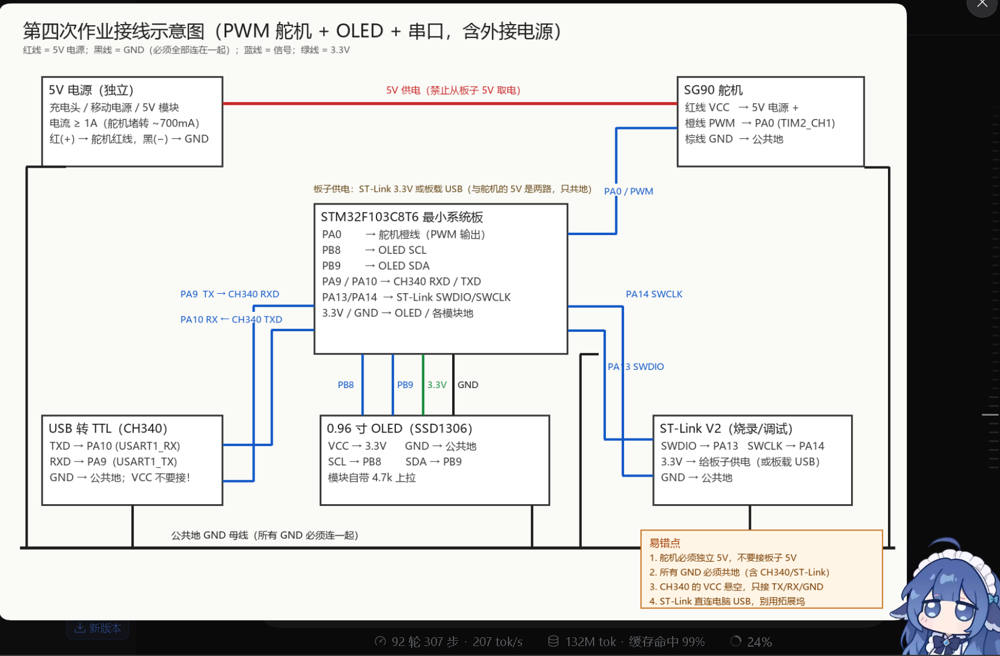

# 电控组第四次培训作业
- **贾政**
- ***20263001720***
## 原理与参数推导

### 时钟树

| 项目 | 配置 |
|---|---|
| HSE | 8MHz 晶振 |
| PLL | ×9 |
| SYSCLK | 72MHz |
| AHB | /1 |
| APB1 | /2 → 36MHz |
| APB2 | /1 → 72MHz |

APB1 分频系数不为 1 时，硬件会把挂在其上的定时器时钟**自动 ×2**，所以 **TIM2 的计数时钟是 72MHz**。

### PSC

目标是让 1 个计数 = 1µs：

```
72,000,000 / (PSC + 1) = 1,000,000
PSC + 1 = 72
PSC = 71
```

### ARR

目标是 50Hz，即周期 20ms = 20000µs：

```
1,000,000 / (ARR + 1) = 50
ARR + 1 = 20,000
ARR = 19999
```

### 验算

```
72,000,000 ÷ (71+1) ÷ (19999+1) = 72,000,000 ÷ 72 ÷ 20,000 = 50Hz ✅
```

### 角度换算

```
CCR = 500 + 角度 / 180 × 2000
```

因为 1 计数 = 1µs，CCR 的数值直接等于脉宽微秒数：0°→500、90°→1500、180°→2500。

### 两端为什么取 550 和 2450

名义 0°~180° 对应 0.5ms~2.5ms，但真实 SG90 行程比标称窄，打满会顶住机械限位，出现"咔咔"声、堵转发热。

因此两端各留约 50µs（≈4.5°）余量：

```c
#define SERVO_CCR_MIN    550u    /* 0.55ms */
#define SERVO_CCR_MAX    2450u   /* 2.45ms */
```

换算函数里先夹角度（0~180）保证公式输入合法，再把 CCR 夹到 550~2450 保证输出绝对安全。
## 接线

## 串口反馈格式
```c
Target=  0  CCR= 550  Pulse=0.550ms
```
| 字段 | 取值 | 说明 |
|---|---|---|
| Target | 0deg-180deg | 目标角度 |
| CCR | 550-2450 | 实际写进寄存器的值 |
| Pulse | 0.550ms-2.450ms | 换算出来的脉宽 |
## 舵机定角转动
| 功能 | 引脚 | 模式 | 备注 |
|---|---|---|---|
| 舵机信号线 | PA0 | TIM2_CH1 ||

定义舵机旋转限度和舵机中位
```c
#define SERVO_CCR_MIN    550u
#define SERVO_CCR_MAX    2450u
#define SERVO_CCR_MID    1500u
```
定义数组长度
```c
#define SEQ_LEN          5u
```
设置舵机的定角序列
```c
static const float g_seq[SEQ_LEN] = {0.0f, 45.0f, 90.0f, 135.0f, 180.0f};
```
设置舵机切换定角延时
```c
#define SEQ_INTERVAL_MS  1000u
```
定义舵机状态，初始化结构体
```c
typedef struct
{
  const float *seq;
  uint8_t      len;
  uint8_t      idx;
  uint32_t     tick;
  uint8_t      started;
  uint8_t      done;
} Seq_t;

static Seq_t g_sched = { g_seq, SEQ_LEN, 0, 0, 0, 0 };
```
定义舵机角度
```c
static float g_angle = 90.0f;
```
定义转换函数`Servo_AngleToCCR`，限制舵机转动的角度，将角度转换为ccr
```c
static uint16_t Servo_AngleToCCR(float angle)
{
  float ccr;

  if (angle < 0.0f)   angle = 0.0f;
  if (angle > 180.0f) angle = 180.0f;

  ccr = 500.0f + angle / 180.0f * 2000.0f;

  if (ccr < (float)SERVO_CCR_MIN) ccr = (float)SERVO_CCR_MIN;
  if (ccr > (float)SERVO_CCR_MAX) ccr = (float)SERVO_CCR_MAX;

  return (uint16_t)ccr;
}
```
定义存入函数`Servo_SetAngle`，将ccr存入定时器2的比较寄存器中
```c
static void Servo_SetAngle(float angle)
{
  __HAL_TIM_SET_COMPARE(&htim2, TIM_CHANNEL_1, Servo_AngleToCCR(angle));
}
```
定义启动函数`Servo_Init`，将中位存入定时器2的比较寄存器中，然后启动PWM
```c
static void Servo_Init(void)
{
  __HAL_TIM_SET_COMPARE(&htim2, TIM_CHANNEL_1, SERVO_CCR_MID);
  HAL_TIM_PWM_Start(&htim2, TIM_CHANNEL_1);
}
```
定义转动函数`Seq_Poll`，按键控制舵机时终止舵机自动转动，首先同步时间，满足延时后使舵机转动下一个定角，并调用发送函数`Servo_Apply`写CCR并发送串口反馈，完成最后一个定角后重新开始
```c
static void Seq_Poll(void)
{
  if (g_sched.done) return;

  if (g_sched.started &&
      (HAL_GetTick() - g_sched.tick) < SEQ_INTERVAL_MS)
    return;

  g_sched.tick    = HAL_GetTick();
  g_sched.started = 1;

  g_angle = g_sched.seq[g_sched.idx];
  Servo_Apply();

  g_sched.idx++;
  if (g_sched.idx >= g_sched.len)
    g_sched.idx = 0;
}
```
## 按键控制舵机
| 命名 | 引脚 | 模式 | 备注 |
|---|---|---|---|
| KEY_ADD | PB1 | 推挽/上拉输入 | 增加角度 |
| KEY_SUB | PB11 | 推挽/上拉输入 | 减小角度 |
定义按键状态，初始化结构体
```c
typedef struct
{
  GPIO_TypeDef *port;
  uint16_t      pin;
  uint8_t       raw;
  uint8_t       stable;
  uint32_t      t_change;
} Key_t;

static Key_t g_key_add = { KEY_ADD_GPIO_Port, KEY_ADD_Pin,  1, 1, 0 };
static Key_t g_key_sub = { KEY_SUB_GPIO_Port, KEY_SUB_Pin,  1, 1, 0 };
```
设置按键控制转动角度和消抖延时
```c
#define KEY_STEP_DEG     15.0f
#define KEY_DEBOUNCE_MS  20u
```
设置两个初始相等的状态变量（raw和stable）和一个时间变量（t_change）  
按按键瞬间，立刻改变第一个状态变量，同时把时间变量改为当前时间  
当两个状态变量不相等且 （当前时间 - 时间变量） 超过了 20ms，同步两个状态变量，认为是一次有效按键
```c
static uint8_t Key_Edge(Key_t *k)
{
  uint8_t raw = (HAL_GPIO_ReadPin(k->port, k->pin) == GPIO_PIN_RESET) ? 0 : 1;

  if (raw != k->raw)
  {
    k->raw = raw;
    k->t_change = HAL_GetTick();
    return 0;
  }

  if (raw != k->stable && (HAL_GetTick() - k->t_change) >= KEY_DEBOUNCE_MS)
  {
    k->stable = raw;
    return (uint8_t)(k->stable == 0);
  }

  return 0;
}
```
定义控制函数`Key_Poll`，对应的按键被确认按下后，终止舵机自动转动，使舵机转动一定角度，超过限位的操作无效，然后写CCR并发送串口反馈
```c
static void Key_Poll(void)
{
  if (Key_Edge(&g_key_add))
  {
    g_sched.done = 1;
    g_angle += KEY_STEP_DEG;
    if (g_angle > 180.0f) g_angle = 180.0f;
    Servo_Apply();
  }

  if (Key_Edge(&g_key_sub))
  {
    g_sched.done = 1;
    g_angle -= KEY_STEP_DEG;
    if (g_angle < 0.0f) g_angle = 0.0f;
    Servo_Apply();
  }
}
```
## 串口发送反馈
| 命名 | 引脚 | 模式 | 备注 |
|---|---|---|---|
| USART1 TX | PA9 | 复用推挽 | 115200 |

串口反馈格式
```c
Target=  0  CCR= 550  Pulse=0.550ms
```
| 字段 | 取值 | 说明 |
|---|---|---|
| Target | 0deg-180deg | 目标角度 |
| CCR | 550-2450 | 实际写进寄存器的值 |
| Pulse | 0.550ms-2.450ms | 换算出来的脉宽 |

定义发送函数`Servo_Apply`，取出角度并将其四舍五入，调用转换函数`Servo_AngleToCCR`算出ccr并写入TIM2的比较寄存器中，然后发送串口反馈
```c
static void Servo_Apply(void)
{
  uint32_t deg = (uint32_t)(g_angle + 0.5f);
  uint16_t ccr = Servo_AngleToCCR(g_angle);

  Servo_SetAngle(g_angle);

  printf("Target=%3u  CCR=%4u  Pulse=%u.%03ums\r\n",
         (unsigned)deg, (unsigned)ccr,
         (unsigned)(ccr / 1000), (unsigned)(ccr % 1000));
}
```
通过串口发送
```c
int _write(int fd, char *ptr, int len)
{
  (void)fd;
  HAL_UART_Transmit(&huart1, (uint8_t *)ptr, (uint16_t)len, 100);
  return len;
}
```
## OLED
| 功能 | 引脚 | 模式 | 备注 |
|---|---|---|---|
| OLED SCL / SDA | PB8 / PB9 | 开漏输出 | 软件 I²C | 

[OLED.c](Core/Src/OLED.c)  
[OLED.h](Core/Inc/OLED.h)  
[OLED_Font.h](Core/Inc/OLED_Font.h)  
文件来源：26电控组招新-群文件-第三次培训所用资料.zip    
更改了引脚配置
### main.c
定义显示函数`Servo_ShowUI`，取出角度并将其四舍五入，调用转换函数`Servo_AngleToCCR`算出ccr，然后刷新OLED屏幕
```c
static void Servo_ShowUI(float angle)
{
  uint32_t deg = (uint32_t)(angle + 0.5f);
  uint16_t ccr = Servo_AngleToCCR(angle);

  OLED_ShowString(1, 1,  "Target:");
  OLED_ShowNum(1, 9, deg, 3);
  OLED_ShowString(1, 12, "deg");

  OLED_ShowString(2, 1,  "CCR   :");
  OLED_ShowNum(2, 9, ccr, 4);

  OLED_ShowString(3, 1,  "Pulse :");
  OLED_ShowNum(3, 9, ccr / 1000, 1);
  OLED_ShowString(3, 10, ".");
  OLED_ShowNum(3, 11, ccr % 1000, 3);
  OLED_ShowString(3, 14, "ms");
}
```
定义刷新函数`Ui_Refresh`，当舵机状态改变后，调用显示函数`Servo_ShowUI`刷新OLED屏幕
```c
static void Ui_Refresh(void)
{
  if (g_shown_deg == g_angle) return;
  g_shown_deg = g_angle;
  Servo_ShowUI(g_angle);
}
```
## USER CODE BEGIN 2
```c
OLED_Init();
setvbuf(stdout, NULL, _IONBF, 0);//关闭标准输出的缓冲区，使串口反馈立刻发送

Servo_Init();

g_key_add.t_change = HAL_GetTick();
g_key_sub.t_change = HAL_GetTick();
```
## 主循环
```c
Seq_Poll();
Key_Poll();
Ui_Refresh();
```


